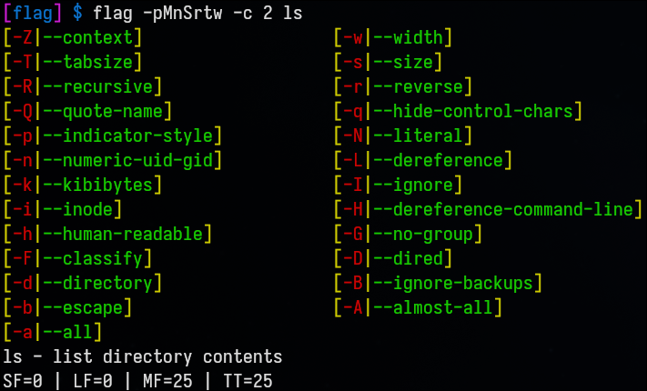
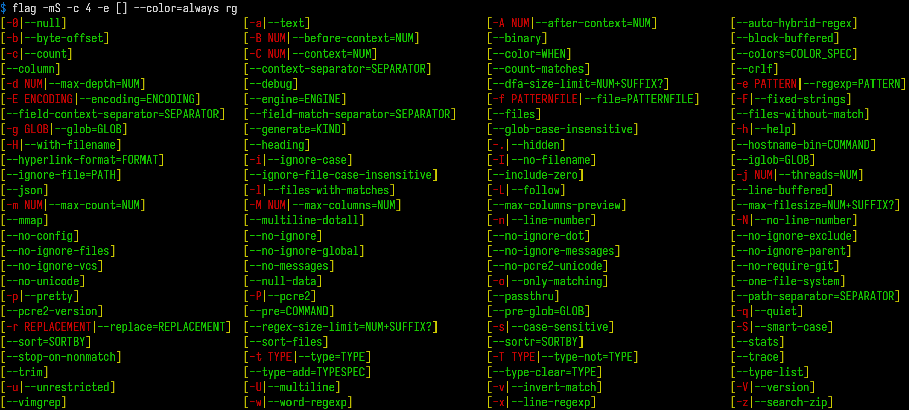

# flag
Fast discovery of command flags from man pages.

# Screenshots of flag in action



# Description
flag is a command-line tool for fast discovery of command flags from man pages. 
flag relies on the man(1) and cat(1) commands for it's functionality to get the man 
page for the specified command and then matches it against a regular expression (regex). 
Because flag uses regex for it's functionality, there are some known 
[limitations](#LIMITATIONS).

# Building
## Dependencies 
depends=('libstdc++' 'libgcc' 'glibc' 'boost-libs')<br>
makedepends=('boost')

## Makefile
```make
# Builds and installs flag
make install

# Uninstalls related files
make uninstall

# Builds the flag binary
make flag

# Builds the testing binary
make flag_test
```

# Known limitations
Considering the fact that regex is used for getting the flags from the man 
pages and there isn't a rigorous standard that most of the man pages follow, 
there are certain limitation to the expected output.

- Firstly, some man pages list a flag and it's aliases on the same line, 
e.g. *--quiet*, *--silent* in head(1), whilst others list different, 
similar flags on the same line, e.g. *-4*, *-6* in traceroute(8). 
This induces an ambiguity where it isn't clear whether the flag is an alias 
or a different, similar flag. In this case the flag command expects there to 
be at maximum one short and one long flag on the same line, hence any 
additional flags are not matched and don't show up in the output. 
This can also cause opposite versions of flags not to be matched if they are 
both defined on the same line, e.g. *--column[=*_<options>_*]*, *--no-column* 
in git-branch(1).

- Secondly, the flag command follows the "POSIX.1-2017" utility 
conventions, which state that: "All options should be preceded by 
the '-' delimiter character". This results in the fact that some flags that 
don't start with the '-' delimiter are not added to the output, e.g. 
*+FIRST_PAGE[:LAST_PAGE]* from pr(1) is ignored.

- Thirdly, there are some commands that implicitly assume that a flag has to 
be prefixed with some sort of a character, e.g. *-Si* in pacman(8). 
In these cases if the prefix is not stated explicitly for each of the flags 
the context is lost and the flags are added to the output without the 
prefix.

- Fourthly, some man pages might contain text in other sections such as 
the *EXAMPLE* section which can't be explicitly classified as not being a 
flag, e.g. *-2* in the fzf(1) *FIELD INDEX EXPRESSION* section. 
These cases lead to false positives where text is matched as being a flag 
even though it isn't a flag.

- Fifthly, the empty long flag *--*, which is often used as a delimiter 
indicating the end of options, is deliberately not matched.

# Examples
`flag ls`<br>
> Show the flags from ls(1).

`flag git log`<br>
> Show the flags from git-log(1).

`flag -n ls`<br>
> Show the flags from ls(1) with no arguments.

`flag --color=always --column=2 --enclose=[] -M -n -S -r -t -w ls`<br>
> Show the flags from ls(1) with colored output, printed in 2 
> columns, prefixed with '[' and suffixed with ']', showing only flags 
> that have both the short and long notations, with no arguments, sorted 
> in the reverse order with the title and flag count added to the bottom 
> of the output.

# Testing
Here are all of the man pages that `flag` has been manually tested against to have 
the expected flag output (obviously considering the aforementioned limitations):

ls(1), id(1), wc(1), head(1), tail(1), date(1), od(1), test(1), echo(1), bzip2(1) (1.0.8), grep(1) (3.12-modified), file(1) (5.48), ifconfig(8) (net-tools 2.10), arp(8) (net-tools 2.10), tcpdump(1) (4.99.7), ping(8) (iputils 20250605), traceroute(8) (2.1.6), netstat(8) (net-tools 2.10), nc(1) (1.101), git(1) (2.56.0), git-add(1), git-bisect(1), git-branch(1), git-checkout(1), git-clean(1), git-commit(1), git-fetch(1), git-init(1), git-merge(1), git-pull(1), git-push(1), git-rebase(1), git-tag(1), docker(1) (29.9.2), docker-commit(1), docker-create(1), docker-logs(1), docker-stats(1), docker-update(1), ssh(1) (OpenSSH_10.6p1), scp(1) (OpenSSL 3.6.5), vim(1) (9.2), nvim(1) (v0.12.6), kitty(1) (0.49.2), tmux(1) (3.8), jq(1) (1.8.2), sed(1) (4.10), zip(1) (v3.0)
fzf(1) (0.74.5), rg(1) (15.2.0).
